> 《建站与运维操作手册》第 一、二 章正文分册；总索引与「按需索取」表见 [OPERATION_MANUAL.md](../OPERATION_MANUAL.md)。章节编号沿用原书，跨章引用（如「见 3.6」）按索引定位。

## 一、 背景与全网现状调研

在目前的各大公开社区（B站 BWIKI、GameKee、Miraheze、NGA、贴吧等）中：
- **现有站点的局限**：所有的游戏资料站均聚焦于**数值养成、卡牌图鉴、副本关卡攻略、突破材料**，对于剧情仅提供粗略的文字大纲或指引去游戏内回看。
- **逐句台词与剧本的空白**：全网**没有任何一个公开网站**完整提取并结构化整理出游戏的**逐句剧情剧本、玩家分支抉择项、约会事件台词全文本**。
- **建站价值**：将本项目独立开源或部署为公共静态站，将填补全网《星塔旅人》剧情数据库的空白，成为玩家查阅剧情细节、考据世界观伏笔、二创作者检索台词的权威基准站。

---

## 二、 知识库核心架构与数据流

本项目的核心目标是**"零胡编、100% 官方数据源保真"**，采用自动化提取管道直接将 Unity 官方解包表转化为渐进式披露的 Markdown 文档树，再由纯 Python 静态站引擎编译成站点。

```mermaid
flowchart TD
    subgraph DataSources["官方解包原始数据 (data/)"]
        A1["CN/bin/*.json<br/>(关卡配置/约会数据/条件表)"]
        A2["CN/language/zh_CN/*.json<br/>(官方文案)"]
        A3["ss_lua/Avg/_cn/Config/*.lua<br/>(AVG 剧本)"]
        A4["ss_lua/Avg/_cn/Preset/*.lua<br/>(角色/词表预设)"]
    end

    subgraph StoryPipeline["剧情编译管线 (scripts/story/)"]
        B1["lua_lexer → lua_parser → command_ir<br/>(Stage 1 前端)"]
        B2["passes：动画帧折叠 / 说话人解析 /<br/>抉择分支归属 / 历史条件标记"]
        B3["conditions：历史条件 ID → 中文标签"]
        B4["markup：内联标记 / 官方词表 / 强调配对"]
        B5["graph_layout：DAG 章节拓扑几何"]
        B6["diagnostics：兜底统一登记"]
    end

    subgraph StoryDocs["人审真源 (story_docs/)"]
        C1["main/ events/ characters/ npc_bonds/<br/>discs/ storysets/ prologue/<br/>dispatch/ battles_unmounted/<br/>anecdotes/ returnee/ soldier/"]
        C2["_data/*.json：chapters / sections /<br/>search / personality（meta 带权威计数）"]
        C3["_beats/*.json：PageDoc IR 侧车"]
        C4["_diagnostics.json：上游异常与兜底登记"]
        C5["_coverage.md / _battle_reconciliation.md"]
    end

    subgraph SitePipeline["静态站引擎 (scripts/site/)"]
        D1["release_gate：未开放内容门控"]
        D2["render_html：beat IR → HTML 正文 + ruby 注音"]
        D3["registry + theme/ + families/：族注册表 / 公共页型 / 族片段"]
        D4["assemble：(family, kind) 分发 + CSS 超级拼接；site_js：离线检索 / 拓扑手势"]
    end

    subgraph Output["发布产物 (site/)"]
        E1["全量静态 HTML（可双击 index.html 离线用）"]
        E2["site/data/*.json + search.js（已过门控）"]
    end

    DataSources --> StoryPipeline
    StoryPipeline --> StoryDocs
    StoryDocs --> SitePipeline
    SitePipeline --> Output
```

**四条设计主线**（改架构前先读懂）：

1. **人审真源与站点产物分离**。`story_docs/` 是逐句校验过的人工核对基准（两份校验器的对照真源），`site/` 是发布产物。站点不再从 md 文本反解结构（早期 `md2html.py` 反编译层已删除），而是与 `render_md.py` **共同消费同一份 `_beats/*.json` PageDoc IR**，因此不存在"第二套渲染器"与产物漂移。
2. **坐标进数据不进代码**。`graph_layout.layout()` 由 `build_story.py` 调用，布局在**建站之前**就能被校验（契约 H）。
3. **发布面单独设闸**。`release_gate.py` 在站点消费任何侧车之前按官方 `OpenTime`/`StartTime` 过滤，未开放组只出占位与提示页，零台词泄露（门控检查）。
4. **兜底不崩 + 必登记**。`pipeline/diagnostics.py` 是唯一的降级登记处；定时同步以 `check=True` 跑生成器，任何未捕获异常都会停摆整条流水线，所以解析/渲染路径一律"产出可读结果 + 登记"，详见 `_dev/AI_HANDOVER_GUIDE.md` 3.6。

> 📏 **规模数字不写死**：各族篇数、页数、台词行数一律以 `story_docs/_data/*.json` 的 `meta` 字段、
> `story_docs/_coverage.md` 与两个校验器结尾的汇总为准。本手册不抄具体数字——抄了就会过时。
